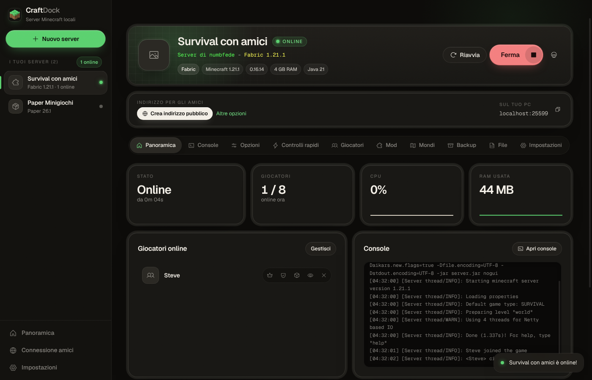

# CraftDock

Organizzatore e launcher di server Minecraft **locali** per Windows, con un pannello in stile Aternos.
I tuoi amici entrano **senza port forwarding** grazie al tunnel playit.gg integrato.

🌐 Sito: **https://craftdock.numbfede.com**



## Download

**[Scarica CraftDock per Windows](https://craftdock.numbfede.com/download)** (installer) oppure la [versione portatile](https://craftdock.numbfede.com/download/portable). I link puntano sempre all'ultima versione pubblicata.

## Novità della 1.2

- Interfaccia in **italiano e inglese** (segue la lingua di Windows, si cambia in Impostazioni).
- **Aggiornamenti dall'app**: avviso quando esce una nuova versione e installazione con un clic.
- **Pianificazione** per ogni server: riavvii, backup, messaggi, comandi, accensione e spegnimento a orario.
- **Supporto**: copia delle informazioni di diagnostica e log dell'app su file.

Tutte le versioni: [CHANGELOG.md](CHANGELOG.md) · pagina [Novità](https://craftdock.numbfede.com/novita).
Firma del codice e avviso SmartScreen: [docs/FIRMA-CODICE.md](docs/FIRMA-CODICE.md).

## macOS

CraftDock gira anche su Mac (Apple Silicon e Intel, macOS 11+). Nello zip c'è `Installa CraftDock.command`:
clic destro → Apri, copia l'app in Applicazioni e toglie il blocco dei file scaricati (l'app non ha ancora
la firma Apple a pagamento). Per il tunnel playit.gg su Mac l'agente si compila una volta dalla pagina
Connessione amici ("Prepara l'agente"), perché playit.gg non pubblica un file pronto per macOS.

Dal codice: `Avvia.command` (serve Node.js 20+). Build: `npm run dist:mac`.

## Avvio dal codice

1. Installa [Node.js](https://nodejs.org) 20 o superiore (versione LTS).
2. Doppio clic su **`Avvia.bat`** (la prima volta installa le dipendenze, poi apre l'app).
3. Per creare l'installer `.exe` e la versione portatile: doppio clic su **`Crea-installer.bat`** → cartella `dist/`.

Da terminale: `npm install`, `npm start`, `npm run dist`, `npm test`.

Java **non** va installato a mano: CraftDock scarica in automatico la versione giusta (Eclipse Temurin 8, 17, 21 o 25) in base alla versione di Minecraft.

## Funzionalità

| Area | Cosa fa |
|---|---|
| **Server** | Crea server Vanilla, **Fabric**, Quilt, Forge, NeoForge, Paper e Purpur scegliendo versione di gioco e del loader. Più server, anche accesi insieme (porte diverse). |
| **Connessione amici** | Agente playit.gg integrato (scaricato in automatico): link di registrazione, rilevamento dell'indirizzo pubblico, indirizzo mostrato e copiabile in ogni server. Rileva anche Tailscale, ZeroTier, Radmin VPN, Hamachi e l'IP di casa. |
| **Opzioni** | Tutto `server.properties` come su Aternos: toggle ✔/✘, numeri con +/−, menu, chiave grezza sotto ogni opzione, editor MOTD con colori e anteprima. Difficoltà, modalità e whitelist si applicano subito a server acceso; le altre dopo il riavvio (con "Salva e riavvia"). Le proprietà sconosciute (aggiunte da mod) restano modificabili. |
| **Controlli rapidi** | Pulsanti per difficoltà, modalità predefinita, orario, meteo, modalità/op/kick/ban/tp/cura dei giocatori, distanza di rendering e simulazione, bordo del mondo e **tutte le game rule** (lette dal server, con i nomi nuovi dalla 1.21.11). |
| **Console** | Output in tempo reale colorato, filtro, cronologia (↑↓), autocompletamento con Tab (comandi, game rule, giocatori online), comandi rapidi, condivisione log su mclo.gs. |
| **Mod / Plugin** | Catalogo **Modrinth** e **CurseForge** (in arrivo) filtrato per loader e versione, dipendenze obbligatorie automatiche, scelta della versione, aggiornamenti via hash, attiva/disattiva, trascina i `.jar`, disattivazione automatica delle mod solo-client. |
| **Modpack** | Nuovo server da Modrinth o file `.mrpack` (CurseForge in arrivo): installa il loader giusto, scarica le mod lato server e copia le configurazioni. |
| **Mondi** | Importa da zip, cartella o direttamente dai salvataggi di Minecraft Launcher, CurseForge, Modrinth App, Prism, MultiMC, ATLauncher, GDLauncher. Mondo attivo, nuovo mondo con seed/tipo, esportazione in zip giocabile in singleplayer, datapack. Conversione automatica Nether/End per Paper/Purpur. |
| **Backup** | Solo mondo o completi, anche a server acceso (save-off + save-all flush), automatici a intervalli e allo spegnimento, rotazione, ripristino con backup di sicurezza preventivo. |
| **Giocatori** | Online, whitelist, operatori, ban giocatori e IP: con server acceso usa i comandi, da spento modifica i file (UUID da Mojang o calcolato per server craccati). |
| **Altro** | Statistiche CPU/RAM, riavvio automatico dopo crash, flag di Aikar, RAM e Java per server, cambio versione/loader con backup, icona del server (64×64), editor dei file di configurazione, notifiche, riduzione nell'area di notifica, chiusura sicura (ferma i server salvando i mondi). |

## Come far entrare gli amici (playit.gg)

1. **Connessione amici → Avvia tunnel.** La prima volta compare un link: aprilo e accedi/registrati su playit.gg (gratis). Se il link non compare usa **Apri finestra playit**.
2. Sul sito playit.gg crea un tunnel **Minecraft Java** verso `127.0.0.1` e la porta del server (es. `25565`).
3. Incolla l'indirizzo ottenuto (es. `nome-casuale.gl.joinmc.link`) nel campo **Indirizzo pubblico**: da quel momento lo vedi in cima a ogni server, pronto da copiare.

Con più server accesi insieme crea un tunnel per ciascuna porta e imposta l'indirizzo specifico in *Impostazioni server → Indirizzo pubblico per questo server*.

## CurseForge

Il supporto a CurseForge è pronto nel codice ma **disattivato** finché l'app non ha una chiave API approvata: nell'interfaccia compare come "in arrivo". Gli utenti non devono configurare nulla.

La chiave non va mai committata (il repository è pubblico). Viene inserita solo al momento del build:

```bat
set CF_API_KEY=la-tua-chiave
npm run dist
```

`scripts/inject-cf-key.js` la scrive in `src/main/cf-key.json` (escluso da git) e l'installer generato ha CurseForge attivo. Senza la variabile il build esce con CurseForge disattivato. In sviluppo si può usare `set CF_API_KEY=... && npm start`.

## Dove finiscono i file

Tutto sta in `%USERPROFILE%\CraftDock` (modificabile in Impostazioni):

```
CraftDock\
  servers\<nome>\   un server per cartella (mondi, mod, configurazioni)
  backups\<id>\     zip dei backup
  java\             runtime Java scaricati
  tools\            agente playit.gg
  cache\            download temporanei
```

## Struttura del codice

```
src/main/          processo principale Electron
  main.js          finestra, IPC, collegamento dei moduli
  loaders.js       versioni e installazione di Vanilla/Fabric/Quilt/Forge/NeoForge/Paper/Purpur
  serverManager.js avvio/arresto, console, giocatori online, statistiche, riavvio dopo crash
  java.js          rilevamento e download di Java (Adoptium)
  mods.js          Modrinth, CurseForge, aggiornamenti, modpack
  worlds.js        mondi, importazione dai launcher, datapack
  backups.js       backup e ripristino
  tunnel.js        playit.gg e reti VPN/LAN
  properties.js    server.properties (preserva commenti e ordine)
  nbt.js           lettura di level.dat
  zip.js, util.js, store.js, preload.js
src/renderer/      interfaccia (HTML/CSS/JS senza framework)
test/run.js        test dei moduli (npm test)
```

## Note

- Le opzioni di `server.properties` che cambiano tra le versioni (pvp, spawn-monsters…) compaiono solo se presenti nel file. Dalla 1.21.9 il PvP è una game rule.
- Tornare a una versione di Minecraft più vecchia può danneggiare il mondo: CraftDock fa sempre un backup prima di reinstallare.
- Minecraft è un marchio di Mojang/Microsoft. CraftDock non è affiliato a Mojang, Aternos, Modrinth, CurseForge o playit.gg.
